  <picture>
    <source media="(prefers-color-scheme: dark)" srcset="assets/header-dark.svg">
    <source media="(prefers-color-scheme: light)" srcset="assets/header-light.svg">
    
  </picture>

I build tools I wish existed: self-hosted, offline-first, and boring to run. Laravel by day, a bit of Rust by night.

  <picture>
    <source media="(prefers-color-scheme: dark)" srcset="https://skillicons.dev/icons?i=laravel,php,mysql,tailwind,vue,rust,docker,linux&theme=dark">
    <source media="(prefers-color-scheme: light)" srcset="https://skillicons.dev/icons?i=laravel,php,mysql,tailwind,vue,rust,docker,linux&theme=light">
    
  </picture>

## Projects

| | |
| :-- | :-- |
| **[linotch](https://github.com/hemreduru/linotch)** · `Rust` | A usage notch for Linux. Claude Code and Codex limits plus media controls, tucked onto a screen edge. |
| **[vizier](https://github.com/hemreduru/vizier)** · `PHP` | Ask your database in plain Turkish or English, get safe read-only reports. Self-hosted, cheap LLMs. |
| **[voicescribe](https://github.com/hemreduru/voicescribe-mobile)** · `React Native` `Laravel` | Offline-first transcription with on-device whisper.cpp. [Mobile app](https://github.com/hemreduru/voicescribe-mobile) + [Laravel backend](https://github.com/hemreduru/voicescribe-backend). |
| **[ciu-skills](https://github.com/hemreduru/ciu-skills)** · `Agent Skills` | Teach your AI tools to make on-brand visuals and video for Cyprus International University. |
| **[project-installer](https://github.com/hemreduru/project-installer)** · `Rust` | A desktop app that turns a fresh Ubuntu box into a Laravel-ready one in a few clicks. |
| **[hursit.me](https://hursit.me)** · `live` | My corner of the internet. |

## Now

Polishing **linotch** and **vizier**, and making AI tooling feel less like a pile of subscriptions.

<picture>
  <source media="(prefers-color-scheme: dark)" srcset="https://raw.githubusercontent.com/hemreduru/hemreduru/output/snake-dark.svg">
  <source media="(prefers-color-scheme: light)" srcset="https://raw.githubusercontent.com/hemreduru/hemreduru/output/snake.svg">
  
</picture>

## Say hi

[hursit.me](https://hursit.me) · [LinkedIn](https://linkedin.com/in/hemreduru) · [Instagram](https://instagram.com/hursit.exe)
